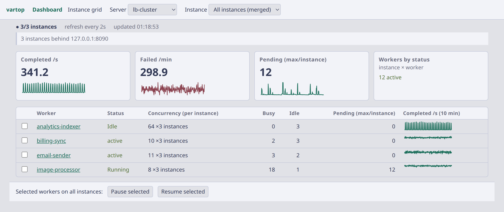
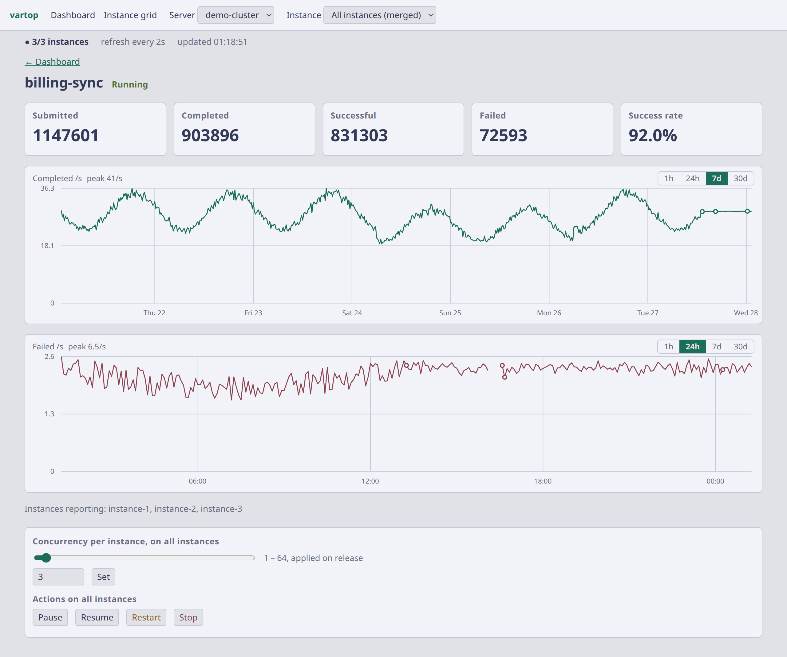
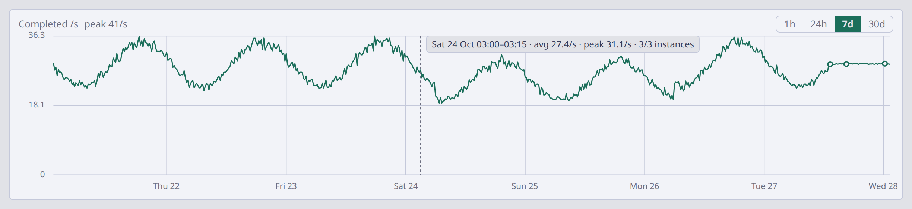
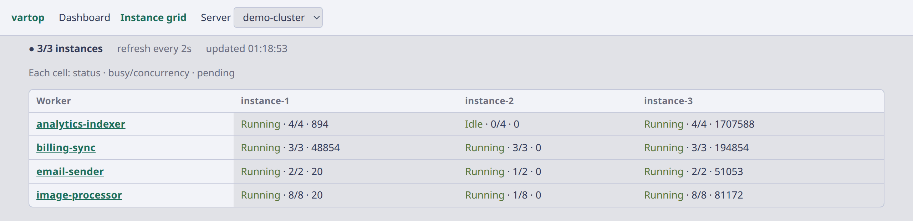
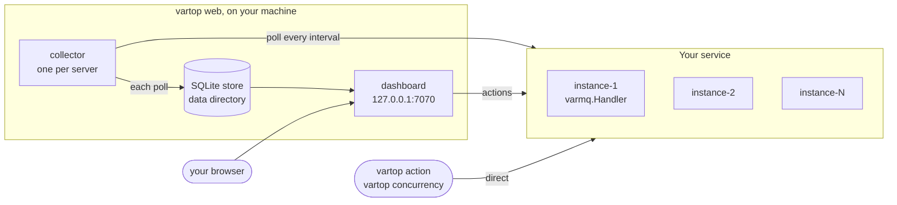

<div align="center">

<h1>vartop</h1>

<p><strong>A live dashboard and control panel for <a href="https://github.com/goptics/varmq">varmq</a> worker fleets.</strong></p>

<p>See every worker on every instance, chart its throughput from the last hour to the last 30 days,<br>
and pause, resume, restart, stop or resize it, from your browser or the command line.</p>

<p>
  
  <a href="#license"></a>
  <a href="https://github.com/goptics/varmq"></a>
</p>

<p>
  <a href="#quick-start"><strong>Quick start</strong></a> ·
  <a href="#tour"><strong>Tour</strong></a> ·
  <a href="#usage"><strong>Usage</strong></a> ·
  <a href="#configuration"><strong>Configuration</strong></a> ·
  <a href="#how-it-works"><strong>How it works</strong></a> ·
  <a href="#development"><strong>Development</strong></a>
</p>

</div>

<picture>
  <source media="(prefers-color-scheme: dark)" srcset="docs/images/dashboard-dark.png">
  
</picture>

## What is vartop?

[varmq](https://github.com/goptics/varmq) is a typed worker pool and message queue for Go. Each process that uses it can serve its workers over a small REST API, `varmq.Handler`. **vartop** talks to that API on every instance of your service and puts the whole fleet in one place:

- **`vartop web`**, a dashboard in your browser. It merges every instance (or shows one), refreshes at each poll, keeps the history in a local SQLite store, and lets you act on workers.
- **`vartop action`** and **`vartop concurrency`**, the same actions from a terminal or a script, against every endpoint of a server at once: each static URL, or each pod or address Kubernetes or DNS discovery finds.

There is no agent to deploy and no database to run: vartop is one binary on your machine. It finds your instances from a fixed list of URLs, the pods behind a Kubernetes Service, or the addresses a DNS name resolves to, and it collects only while `vartop web` runs.

## Features

**Watch**

- **Fleet dashboard.** Completed per second, failed per minute, pending jobs and workers by status, with a 10-minute trend per worker.
- **Instance grid.** Every worker on every instance at a glance: status, busy/concurrency, pending.
- **Worker page.** Totals and success rate, and two charts (completed /s, failed /s), each with its own **1h | 24h** switch, plus **7d** and **30d** as far as the server's `history` reaches, axes and a hover readout.
- **History that survives restarts.** 24 hours of polls, and up to 30 days of each worker's rates per server, in a local SQLite store.
- **Stale data called out.** A banner says how old the data is and why, instead of showing old numbers as current.

**Act**

- **Pause, resume, restart, stop**, and a concurrency slider, on every instance or on one; pause or resume several workers at once.
- **The same from the CLI**, fanned out to every endpoint concurrently, one result line each.

**Find every instance**

- **Static endpoints, or Kubernetes EndpointSlices and DNS**, the last two followed live as instances scale, restart or move.
- **Load-balancer detection.** One URL answered by several instances is recognised, and each instance behind it is listed.

**Safe by default**

- **Loopback only.** The dashboard has no login, so it only listens on a loopback address (`127.0.0.1`, `localhost`, `::1`, …).
- **The token stays on the server.** vartop calls varmq on the page's behalf; the bearer token never reaches the browser.
- **Actions only on current data.** An action is refused, and nothing is sent, while the data is stale or was collected under another configuration.

## Prerequisites

**Your service serves varmq's REST API** on each instance. Mount `varmq.Handler` on any `http.ServeMux` (see [varmq's REST API](https://github.com/goptics/varmq#rest-api)):

```go
mux := http.NewServeMux()
mux.Handle("/varmq/", varmq.Handler("/varmq"))
http.ListenAndServe(":8080", mux)
```

vartop then calls `http://<instance>:8080/varmq`. The API is unauthenticated by design: keep it on a trusted network, or put it behind a proxy that checks a bearer token and give vartop that `token` (sent as `Authorization: Bearer <token>`).

**vartop reaches each instance directly** when it discovers them through [Kubernetes](#kubernetes) or [DNS](#dns): run it inside the network, or over a VPN or route that reaches their addresses.

**Go 1.26+** to install it (the Kubernetes client libraries need it).

## Quick start

1. **Install**

   ```bash
   go install github.com/goptics/vartop@latest
   ```

   Or build from source: `git clone https://github.com/goptics/vartop.git && cd vartop && make build` (binary at `bin/vartop`).

2. **Open the dashboard.** On first run a short wizard sets up your first server: a name, then a **static endpoint**, **Kubernetes** discovery (context, namespace, service or label selector) or **DNS** discovery (host and port), and an optional token.

   ```bash
   vartop web
   ```

   It opens http://127.0.0.1:7070 and collects every configured server until you stop it with <kbd>Ctrl+C</kbd>.

3. **Add more servers**, from another terminal; a running `vartop web` picks them up within a few seconds:

   ```bash
   vartop server add                      # the same wizard
   vartop server set prod endpoint "http://pod-0:8080/varmq,http://pod-1:8080/varmq"
   vartop server set prod history 30d     # 7d and 30d charts for prod
   vartop server use prod                 # the default server
   ```

4. **Act from the terminal**:

   ```bash
   vartop action orders pause             # every endpoint of the default server
   vartop -s staging concurrency orders 8 # 8 per instance on staging
   ```

## Tour

### Dashboard

The page above. One row per worker, merged across every instance (or one instance, from the **Instance** picker), with its status, concurrency, busy and idle workers, pending jobs and a 10-minute trend. Tick several workers to pause or resume them together. The header says how many instances answered, and here, that three of them answered behind one load-balancer URL.

### Worker page

<picture>
  <source media="(prefers-color-scheme: dark)" srcset="docs/images/worker-dark.png">
  
</picture>

Click a worker for its totals and success rate, its two charts, and its controls. Each chart has its own span: **1h** from the stored polls, **24h** from 5-minute buckets, and **7d**, **30d** (or the server's own [`history`](#schema), like `14d`) merged into longer steps. Hovering a chart shows how many instances answered and, on 1h, the poll's time and value; on longer spans, the exact window, its average and its peak:

<picture>
  <source media="(prefers-color-scheme: dark)" srcset="docs/images/chart-hover-dark.png">
  
</picture>

The concurrency slider sets the pool size per instance, applied when you let go; **Pause**, **Resume**, **Restart** and **Stop** act on every instance shown.

### Instance grid

<picture>
  <source media="(prefers-color-scheme: dark)" srcset="docs/images/grid-dark.png">
  
</picture>

Every worker on every instance: spot the one instance that is idle, stuck or behind.

## Usage

### `vartop web`

Serves the dashboard and opens it in your browser. While it runs it collects **every configured server** (see [Collection](#collection)), so switching servers on the page is instant and their charts are already drawn.

```bash
vartop web                             # http://127.0.0.1:7070, default server
vartop web -s staging                  # a specific server first
vartop web --port 9000                 # another port
vartop web --host localhost --port 0   # any free port
vartop web --no-open                   # print the URL, don't launch a browser
```

| Flag | Description | Default |
| --- | --- | --- |
| `--host` | Host to listen on (must be a loopback address) | `127.0.0.1` |
| `--port` | Port to listen on; `0` picks any free port | `7070` |
| `--no-open` | Don't open the browser | *(opens it)* |
| `-s`, `--server` | Server to show first; the page can switch to any configured server | *(default server, else the first configured)* |

Press <kbd>Ctrl+C</kbd> to stop; collection stops with it.

### Command line

| Command | Description |
| --- | --- |
| `vartop` | Print help |
| `vartop web` | Serve the dashboard and collect every server while it runs |
| `vartop server list` | List all servers (static servers with their health status) |
| `vartop server add` | Register a new server via the interactive wizard (static, Kubernetes or DNS) |
| `vartop server use <name>` | Set the default server |
| `vartop server remove <name>` | Remove a server (`--all`: every server) |
| `vartop server set <name> endpoint\|token\|interval\|history <value>` | Update a server property (`endpoint` accepts a comma-separated list, static servers only; `history` is whole days, `1d` to `30d`) |
| `vartop action <worker> pause\|resume\|restart\|stop` | Act on a worker |
| `vartop concurrency <worker> <n>` | Set a worker's concurrency pool size |
| `-s`, `--server <name>` | The server `web`, `action` and `concurrency` use (overrides the default) |

`action` and `concurrency` run against **every endpoint** of the server (each static endpoint, or each pod or address Kubernetes or DNS discovery finds) concurrently and print one result line per endpoint; the command fails if any endpoint fails. Behind a load-balancer URL that is one instance, the one the balancer picks: see [Load balancers](#load-balancers). `concurrency` is per instance, so `concurrency orders 8` on 3 endpoints gives 24 workers in total. To target one endpoint, pass its URL:

```bash
vartop action orders pause                                        # every endpoint
vartop action orders pause --origin http://10.0.0.5:8080/varmq    # one endpoint
vartop -s staging concurrency orders 8
```

### URL parameters

A page's address says what it shows, by the names the page shows, so a reload, the refresh and a shared link keep it:

| Parameter | Meaning |
| --- | --- |
| `server=<name>` | The configured server to show, by the key it is listed under in the config (the default server when absent, else the first configured server by name) |
| `instance=<label>` | Off Kubernetes: only that instance, e.g. `?instance=instance-2` |
| `pod=<pod name>` | On Kubernetes: only that pod |
| `completed=<span>`, `failed=<span>` | On a worker page: the span of that chart, `24h`, `7d`, `30d` or the server's history (e.g. `14d`); without it, the hour |

Without `instance` or `pod` the page shows every instance (on Kubernetes, every pod) merged. An old `pod=` link opens the merged view: that is a `pod=` on a server that is not on Kubernetes, or on a Kubernetes one a value that is an endpoint key (`#…` or a URL), not a pod name. A label the server never had says so; one that is no longer reported says that, with a link to the merged view. A span the server's history does not offer (a link from before it was shortened, say) shows the hour.

## Configuration

Configuration lives in your OS user config directory, created on first run (directory `0755`, file `0600` since it may hold tokens). A running `vartop web` watches the file and picks up changes to it (see [Collection](#collection)):

| OS | Path |
| --- | --- |
| Linux | `$XDG_CONFIG_HOME/vartop/config.json` (default `~/.config/vartop/config.json`) |
| macOS | `~/Library/Application Support/vartop/config.json` |
| Windows | `%AppData%\vartop\config.json` |

If `config.json` is a symlink, say into a dotfiles repository, vartop saves through it and the link stays.

### Schema

Each server uses **exactly one** of `endpoints` (static list), `kubernetes` or `dns` (live discovery). Setting more than one, or none, is rejected when the config is loaded.

```json
{
  "default_server": "production",
  "servers": {
    "production": {
      "name": "production",
      "endpoints": ["http://pod-0:8080/varmq", "http://pod-1:8080/varmq"],
      "token": "optional-bearer-token",
      "interval": 5,
      "history": "30d"
    },
    "cluster": {
      "name": "cluster",
      "kubernetes": {
        "context": "prod-eu",
        "namespace": "workers",
        "service": "varmq-mux",
        "port": 8080,
        "path": "/varmq"
      },
      "token": "optional-bearer-token"
    },
    "headless": {
      "name": "headless",
      "dns": {
        "host": "varmq-headless.workers.svc.cluster.local",
        "port": 8080,
        "path": "/varmq"
      }
    }
  }
}
```

| Field | Description | Default |
| --- | --- | --- |
| `default_server` | Server to use when no `-s` flag is given | *(none)* |
| `servers.<name>.endpoints` | Static list of mux endpoint URLs (one for a single instance, several for more) | *(one of endpoints / kubernetes / dns)* |
| `servers.<name>.kubernetes` | Kubernetes discovery block, see [Kubernetes](#kubernetes) | *(one of endpoints / kubernetes / dns)* |
| `servers.<name>.dns` | DNS discovery block, see [DNS](#dns) | *(one of endpoints / kubernetes / dns)* |
| `servers.<name>.token` | Bearer token for authentication (sent as `Authorization` header) | *(none)* |
| `servers.<name>.interval` | How often vartop web polls the server, in seconds | `5` |
| `servers.<name>.history` | How far back a worker page's charts reach: whole days, `1d` to `30d`. Each worker's rates are kept that long, in 5-minute buckets (about 4–5 MB a day for 10 instances of 20 workers); lowering it drops the older ones within 5 minutes, and later buckets reuse their space (the file does not shrink) | `1d` |

### Kubernetes

| Field | Description | Default |
| --- | --- | --- |
| `context` | kubeconfig context to use (kubeconfig is read from `$KUBECONFIG` or `~/.kube/config`, in the [environment](#environment) vartop web runs in) | *(required)* |
| `namespace` | Namespace of the varmq pods | *(required)* |
| `service` | Service name; pods are found via its EndpointSlices (`kubernetes.io/service-name=<service>`) | *(one of service / selector)* |
| `selector` | EndpointSlice label selector, e.g. `app=varmq-mux` | *(one of service / selector)* |
| `port` | Port to dial on each pod | first port on the EndpointSlice |
| `path` | Mux API path on each pod | `/varmq` |

Only **ready** endpoints are used, so pods that are starting up or terminating are skipped, and pods are labelled by pod name. The `server add` wizard asks for context, namespace, and service or selector; to change `port` or `path`, edit the config file.

- **Reachable pod IPs.** vartop dials each pod directly at `http://<pod-ip>:<port><path>`. There is no port-forward or API-server proxy, so run it from inside the cluster network or over a VPN or route that reaches pod IPs.
- **RBAC.** Your kube identity needs `list` and `watch` on EndpointSlices in the namespace:

  ```yaml
  apiVersion: rbac.authorization.k8s.io/v1
  kind: Role
  metadata:
    name: vartop
    namespace: workers
  rules:
    - apiGroups: ["discovery.k8s.io"]
      resources: ["endpointslices"]
      verbs: ["list", "watch"]
  ```

- **Plain HTTP.** Pods are dialed over `http://`. If you set a `token`, it travels unencrypted on the pod network, so only use it where that network is trusted.

If the watcher can't sync within 10 seconds (wrong context, no access, API server unreachable), vartop shows the underlying error, and vartop web tries again with a growing delay (5 seconds, doubling up to 5 minutes).

### DNS

Resolves a hostname to **all** of its addresses and dials each one, re-resolving every 5 seconds so instances that scale out or move are picked up. Works anywhere a name returns one address per instance:

- a Kubernetes **headless** Service (`clusterIP: None`): no kubeconfig or RBAC needed, handy when vartop runs inside the cluster
- a Docker Compose service name with several replicas (`tasks.<service>` on Swarm)
- Consul, Nomad, or AWS Cloud Map service DNS

| Field | Description | Default |
| --- | --- | --- |
| `host` | Hostname to resolve (A/AAAA records) | *(required)* |
| `port` | Port each instance serves the mux on | *(required)* |
| `path` | Mux API path on each instance | `/varmq` |

An unresolvable host fails at connect time with the lookup error; a failed refresh later keeps the last known instances. Like Kubernetes discovery, instances are dialed directly over `http://`, so their addresses must be reachable from vartop. The `server add` wizard asks for host and port; edit the config file to change `path`.

## How it works



`vartop web` runs a **collector** for each configured server. At every interval it polls each instance's REST API, works out each worker's rates, and writes the result to that server's file in a local SQLite store. The pages read only that store, never varmq, so every browser tab sees the same numbers and switching servers is instant. An action from the page goes to varmq from the vartop process, with the server's token. The CLI does not use the store: `vartop action` and `vartop concurrency` call each configured or discovered endpoint directly.

### Collection

`vartop web` polls **every configured server** while it runs, not only the one on screen, and writes what it sees to a local SQLite store with 24 hours of polls, and each worker's rates for the server's `history`. Its pages read that store. When it stops, collection stops too: nothing keeps running in the background.

- **It follows the config file.** Adding, editing or removing a server (with `vartop server add` in another terminal, say) takes effect within a few seconds. Deleting `config.json` stops all collection, as if every server were removed; the servers' files stay for 24 hours after their last write, so putting the config back within a day resumes the history. A config that stops parsing or validating while vartop web runs changes nothing: it keeps collecting with the last good one and logs the error. (A broken config keeps vartop web from starting.)
- **One collector per data directory.** A second `vartop web` on the same machine (on another `--port`) does not collect: it logs *another vartop is collecting into this data directory; this one shows what it collects, and takes over once it stops* and shows what the first one collects. Within about 5 seconds of the first one stopping (about 11 if it crashed), it collects itself.
- **After a crash**, the dead process's lease stays valid for up to 15 seconds. A `vartop web` started meanwhile watches the lease's heartbeat for 6 seconds and takes it over if it does not move.
- **Its data directory deleted** while it runs (by a cache cleaner, say), vartop web stops, whether it collects or only shows what another collects, with *data directory removed: {dir} no longer holds the control.db …; start vartop web again*.
- **History stored by an older vartop is filled into the 24h charts once.** A server file from before the 5-minute buckets has its stored polls summed into them in the background after vartop web starts: 50 polls at a time, each batch followed by a pause at least as long, and without holding anything the collector's own polls or the lease need, so collection carries on meanwhile. That takes about 15 seconds for 12,000 polls of a small fleet, and about 45 seconds per server for a full day of a 10 × 20 server polled every 5 seconds. Until it is done, the 24h charts show the part already filled.
- **It logs state changes only**, to its terminal: servers added, removed or restarted, a server that cannot be polled at all (its discovery failing: a Kubernetes watcher that cannot sync, a DNS name that does not resolve) and its recovery, store problems, and who collects. Instances that stop answering, even all of them, show on the page, not in the log.

### Charts

- **Charts keep the time axis.** The sparklines span a fixed 10 minutes and the detail charts the hour (or the span chosen below), each point placed at the time it was taken; a line breaks where polls are missing (vartop web was not running, or the server unreachable), so a gap shows as a gap.
- **The detail charts have axes and a hover readout.** The two 1 h charts on a worker's page show the clock every 10 minutes along the bottom and a scale of 0, half the peak and the peak on the left, with faint gridlines. Hovering a chart draws a crosshair at the nearest poll and shows its time, value and how many instances answered, at once; over a stretch with no polls it shows nothing. A tap does the same on a touch screen. The dashboard's sparklines stay compact, with no axes.
- **Each chart shows the hour, the day, or longer.** Completed /s and Failed /s on a worker's page each have a switch of their own: **1h | 24h**, then **7d** and **30d** as far as the server's [`history`](#schema) reaches, and the history itself when it is neither (**14d**, say). At 24h a chart spans the last day in 5-minute buckets: each point is the bucket's average rate, hovering one shows *13:05–13:10 · avg 12.4/s · peak 15.1/s · 3/3 instances* (how many answered at the poll in that window that missed the most; a poll at which none answered shows only on the 1h chart), the caption's peak is the span's highest single poll, and the clock is marked every 6 hours. A longer chart merges the buckets into the shortest of 5, 10, 15, 20, 30 and 60 minutes that gives it at most 720 points (7d: 15 minutes, 30d: an hour), dates its points (*Tue 27 Oct 13:00–14:00 · …*) and marks local midnights: every day for a week, every few days beyond. The choice is in the address (`?completed=24h&failed=7d`), so a reload, the refresh, the instance picker and a shared link keep it; a span the server's history does not offer (a link from before it was shortened, say) shows the hour. The dashboard's 10-minute trends stay as they are.
- **History survives a restart.** Charts are drawn from what was stored, so they are back when you start `vartop web` again.

### Safety

<details>
<summary><strong>What the dashboard shows, and when it refuses to act</strong></summary>

- **Loopback only.** The dashboard has no login, and whoever reaches it can stop your workers, so vartop refuses any `--host` that is not a loopback address (`127.0.0.1`, `localhost`, `::1`), and the server only answers requests addressed to its own loopback host name.
- **The token stays on the server.** vartop calls varmq on the page's behalf; the bearer token is never sent to the browser.
- **Stale data is visible.** When no new data has arrived for three times the polling interval plus 2 seconds, a banner says how old the data is and why (vartop web is not collecting, or the server's error). Everything current shows `—` or is hidden (the values, the health count, the load-balancer note, per-instance errors, the list of reporting instances), and the history stays drawn. A server with only old history, say after vartop web was not running for hours, shows the same banner with its age, not "Waiting for the first snapshot".
- **Another configuration is refused.** Two `vartop web` on one machine share the [data directory](#data-directory), and only one collects (see [Collection](#collection)). If the one collecting reads another config file or `KUBECONFIG`, the other's pages read *Another vartop (pid {pid}) is collecting with another configuration; this vartop web collects once it stops.*, the current values show `—`, and every action is refused with that text (HTTP 409) and sends nothing: its snapshots name endpoints found under the other configuration, and this server's token must not go to them. The check reads the last collector's lease, running or not, so it holds after that one stopped or crashed too, until this vartop web collects.
- **Only current data is shown or acted on.** A snapshot is current when it is not stale, the collector's configuration is this vartop's, and it was not taken before that collector started: an older one is a previous collector's. Right after vartop web starts, or takes over from another, the page therefore shows `—` and *No new data for {age}.* and refuses actions (HTTP 409, nothing sent) until its first snapshot, up to about two polling intervals (longer while Kubernetes discovery connects). With nothing collecting, an action is refused at once, with *… — vartop web is not collecting.* If the collector's lease cannot be read, actions are refused with *cannot read the collector's lease: {err}* and the page keeps showing data by the stale rule above. After a server's endpoints (or Kubernetes or DNS settings) are edited, its newest snapshot still names the old units until the collector restarts it, a few seconds; an action meanwhile is refused with *The configuration of {server} changed; actions wait for its first snapshot under it. Try again in a few seconds.*, and nothing is sent: this server's token must not go to endpoints the config no longer lists.
- **Connecting takes a moment.** While vartop web is still connecting to a server (a Kubernetes watcher can take a few seconds to sync), the page says it is waiting for the server's first snapshot. If the connection fails, the real cause (for example an RBAC `forbidden` error) is shown with the server's name.

</details>

### Instance labels

Outside Kubernetes the page says **instance** where Kubernetes says pod, and labels each one instance-1, instance-2, … in the order vartop first sees them, static and DNS endpoints included; hover a label for its instance ID and address. A label's number follows the instance ID, so it stays put when an endpoint turns out to be a load balancer, and stays with an address while its instance is down; an instance that comes back with a new ID gets a new number. Labels are stored per server, so they survive restarting vartop web; a number not seen for 24 hours is freed, and a new instance takes the lowest free number.

### Load balancers

If a server is configured with a single **load-balancer URL** (an ingress, nginx, a cloud LB, or a normal ClusterIP Service), every request reaches *one* instance chosen by the balancer. varmq adds an `X-Varmq-Instance` header naming the process that answered every API request, defaulting to the hostname (the pod name on Kubernetes) and settable via `varmq.InstanceID`.

- **The CLI** can't aggregate through a balancer, so it makes the situation visible: an action reaches one instance, not all of them (a `pause` and the following `resume` can land on different instances), and a successful result line names the instance that answered (`127.0.0.1: ok (instance pod-c)`).
- **vartop web** sends requests through the balancer on new connections until every instance it knows of has answered or a retry limit is reached. The dashboard then lists every instance behind the balancer as an entry of its own, labelled like any other, and its header says how many answered behind each balancer endpoint (*3 instances behind 127.0.0.1:8090* in the screenshot at the top). Detection is best-effort: a balancer that keeps a client on one backend per connection (most L4 balancers, kube-proxy) is still noticed, since every attempt is a new connection, but only instances that answered can be reported.

<details>
<summary><strong>Acting through a balancer, and its cost</strong></summary>

Actions on **All instances (merged)** go through the balancer until every instance has answered or the retry limit is reached (at most 15 seconds), one result line each. Since the balancer picks which instance answers, an instance reached only through it has no actions of its own, and **Restart** is hidden on the merged view whenever such an instance is in it.

**To restart or act on one instance, skip the balancer:** use [`kubernetes`](#kubernetes) discovery, [`dns`](#dns) with a headless Service or service-discovery name, or list the instance URLs in `endpoints`. A cloud load balancer's own hostname resolves to the balancer's nodes, not your instances, so `dns` doesn't help there.

To reach every instance, vartop opens roughly K·(1 + ln K) short-lived connections per worker per refresh through a balancer with K instances behind it; for large fleets prefer `kubernetes` or `dns` discovery, or an interval of 5 seconds or more.

</details>

> **Distributed queues:** with a shared (e.g. Redis) queue, every instance reports the same queue length as *Pending*, so don't add Pending up across rows.

### Environment

What vartop web can reach depends on the environment you start it in: the config path (`XDG_CONFIG_HOME` or `HOME`), `KUBECONFIG`, the credential plugins on `PATH` that EKS, GKE and AKS kubeconfigs call, proxies, `VARTOP_DATA_DIR`. Two `vartop web` that differ in config path or `KUBECONFIG` share the data directory but not each other's configuration: see *Another configuration is refused* under [Safety](#safety).

### Data directory

The store lives in `VARTOP_DATA_DIR` when that is set, else in `vartop` under your OS user cache directory:

| OS | Default path |
| --- | --- |
| Linux | `$XDG_CACHE_HOME/vartop` (default `~/.cache/vartop`) |
| macOS | `~/Library/Caches/vartop` |
| Windows | `%LocalAppData%\vartop` |

| File | Holds |
| --- | --- |
| `control.db` | The collector's lease, the pages' requests to poll now, and each server's last collection error |
| `servers/<name>-<hash>.db` | One file per configured server: its snapshots (24 hours), each worker's rates in 5-minute buckets for the 24h and longer charts (summed as each poll is stored, kept for the server's `history`), and its instance labels |

The directory is created `0700` and its files `0600`. Tokens are never stored there: vartop web reads them from the [config](#configuration) when it polls. A server's file is deleted 24 hours after its last write. A configured server is written every poll while vartop web runs, so that is about 24 hours after the server left the config: removing a server by mistake and adding it back under the same name within a day keeps its history. A vartop web started after more than 24 hours deletes the file of a server that is no longer configured as soon as it starts: its snapshots were past retention anyway, so what is lost is the server's instance numbers and, with a `history` past `1d`, the rest of its longer charts.

### Disk use

A busy server, with 10 instances of 20 workers each, polled every 5 seconds, takes about **149 MB a day** (roughly 8.6 KB on disk per poll). Snapshots are kept for 24 hours, and each server's snapshots are capped at **256 MB**: past that, the oldest go first. A server about 1.7 times busier than that one, by workers, instances or a shorter interval, therefore keeps less than 24 hours of snapshots. The 1h charts are not affected, and neither are the longer ones: they read the 5-minute buckets, which the cap leaves alone. Those take about **4–5 MB a day** for that server, whatever its interval, and are kept for the server's `history`: up to about 150 MB beside the snapshots at `30d`. Smaller fleets and longer intervals scale the snapshot figure down roughly in proportion: per day, bytes per poll × 86,400 ÷ the interval in seconds; the buckets scale with workers × (instances + 1).

## Development

| Command | Description |
| --- | --- |
| `make build` | Compile binary to `bin/vartop` |
| `make run` | Build and run `vartop web` |
| `make test` | Run all tests |
| `make clean` | Remove build artifacts |

```bash
go build -o bin/vartop main.go
./bin/vartop web
go test ./...
```

<details>
<summary><strong>Project layout</strong></summary>

```
vartop
├── cmd/                    # Cobra CLI commands
│   ├── root.go             # Root command, onboarding
│   ├── server.go           # Server management subcommands
│   ├── web.go              # `vartop web`: serves the dashboard and runs the collector while it does
│   └── workers.go          # Worker action & concurrency subcommands (fan out to all pods)
├── internal/
│   ├── api/
│   │   ├── client.go       # REST client for one varmq mux endpoint (+ instance header tracking)
│   │   └── pool.go         # One client per discovered pod, reconciled from a discovery source
│   ├── config/
│   │   ├── config.go       # Config load/save + validation (<config dir>/vartop/config.json)
│   │   └── prompt.go       # Interactive onboarding / server add wizard
│   ├── discovery/
│   │   ├── discovery.go    # Source interface: live set of ready endpoint URLs
│   │   ├── static.go       # Fixed endpoint list from config
│   │   ├── kubernetes.go   # EndpointSlice informer (client-go) for a service or selector
│   │   └── dns.go          # Re-resolves a hostname to every instance address
│   ├── fleet/              # Model of a varmq fleet, no HTTP
│   │   ├── poller.go       # Collector: polls every unit of a server into snapshots
│   │   ├── history.go      # Snapshot types, rate calculator, 1 h ring
│   │   ├── day.go          # 5-minute buckets, merged into the 24h, 7d and 30d charts
│   │   ├── balancer.go     # Reaches every instance behind a load balancer
│   │   ├── view.go         # Snapshots → dashboard, grid and detail view models
│   │   ├── act.go          # Worker action core, and the dashboard's notices
│   │   ├── noun.go         # pod / instance wording and the URL parameter
│   │   └── fleettest/      # Fake varmq servers and load balancers for tests
│   ├── store/              # SQLite store the collector writes and the pages read
│   │   ├── dir.go          # Data dir, file names, pragmas, retention and size cap
│   │   ├── control.go      # control.db: the collector's lease, pokes, server errors
│   │   ├── server.go       # One file per server: snapshots, labels, pruning
│   │   ├── buckets.go      # Each worker's 5-minute buckets, kept for the server's history
│   │   ├── codec.go        # Snapshot ↔ compressed record
│   │   └── feed.go         # Reader: loads the 1 h window, then tails new rows
│   ├── collect/
│   │   ├── collect.go      # Run: lease, config watcher, pokes, pruning
│   │   ├── collector.go    # One per server: poll → writer → the server's file
│   │   └── config.go       # Watches the config file for changes
│   └── web/
│       ├── server.go       # Loopback listener, Host/CSRF guards, page handlers
│       ├── actions.go      # Worker action, concurrency and bulk POST routes
│       ├── day.go          # The charts' span switch and their longer spans
│       ├── render.go       # Template loading, page model, chart axes
│       ├── templates/      # HTML pages (htmx-driven, server-rendered)
│       └── static/         # Embedded CSS, the detail page's script (chart hover, concurrency inputs) and vendored htmx
├── docs/                   # Design spec, and the README's screenshots
├── main.go                 # Entry point
├── Makefile                # Build, run, clean, test targets
├── go.mod
└── go.sum
```

</details>

<details>
<summary><strong>varmq API endpoints used</strong></summary>

| Method | Path | Purpose |
| --- | --- | --- |
| `GET` | `/health` | Server health check |
| `GET` | `/workers` | List all workers with status |
| `GET` | `/workers/{name}` | Worker details & runtime metrics |
| `PATCH` | `/workers/{name}/actions/{action}` | Pause, resume, restart, stop |
| `PATCH` | `/workers/{name}/config/concurrency/{n}` | Update concurrency pool size |

</details>

<details>
<summary><strong>Dependencies</strong></summary>

| Library | Purpose |
| --- | --- |
| [Huh](https://github.com/charmbracelet/huh) | Interactive form prompts (onboarding, `server add`) |
| [Lip Gloss](https://github.com/charmbracelet/lipgloss) | Styling of those prompts |
| [Cobra](https://github.com/spf13/cobra) | CLI command parsing |
| [pterm](https://github.com/pterm/pterm) | Big-text ASCII art banner |
| [client-go](https://github.com/kubernetes/client-go) (+ `k8s.io/api`, `k8s.io/apimachinery`) | Kubernetes EndpointSlice discovery |
| [modernc.org/sqlite](https://pkg.go.dev/modernc.org/sqlite) | Pure-Go SQLite (no cgo) for the history store |
| [htmx](https://htmx.org) (vendored) | The dashboard's live updates, without a build step |

</details>

## Contributing

Contributions are welcome:

1. Fork the repository
2. Create a feature branch (`git checkout -b feat/amazing-feature`)
3. Make your changes
4. Run tests (`make test`)
5. Commit using [conventional commits](https://www.conventionalcommits.org/)
6. Push and open a pull request

Please keep the code idiomatic, the dashboard usable from phone to desktop widths, and include tests for new functionality.

## License

MIT © [Fahim Faisaal](https://github.com/fahimfaisaal). See [LICENSE](LICENSE).

## Acknowledgements

vartop's onboarding wizard is built on [Charmbracelet](https://charm.sh)'s Huh and Lip Gloss, and the dashboard on [htmx](https://htmx.org).
