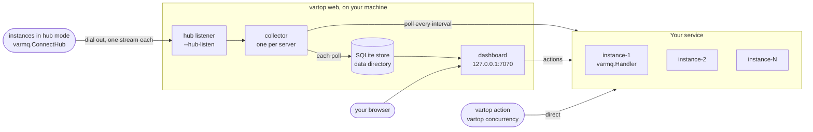

# How it works

`vartop web` runs a **collector** for each configured server. At every interval it polls each instance's REST API and works out each worker's rates. It writes the result to that server's file in a local SQLite store. The dashboard, the instance grid and the worker pages read only that store. Every browser tab therefore sees the same numbers, and switching servers is instant. The queue, job and workflow pages read VarMQ live, from the vartop process, at each request. They ask the instances in the current snapshot. An action from the page goes to VarMQ from the vartop process, with the server's token. The CLI does not use the store: `vartop action` and `vartop concurrency` call each configured or discovered endpoint directly. In [hub mode](hub.md) the instances dial vartop instead, and the same requests go down each instance's stream.

## Collection

`vartop web` polls **every configured server** while it runs, not only the one on screen. It writes what it sees to a local SQLite store: 24 hours of polls, and each worker's rates for the server's `history`. Its dashboard, grid and worker pages read that store. When it stops, collection stops too: nothing keeps running in the background.

- **It follows the config file.** Adding, editing or removing a server (with `vartop server add` in another terminal, say) takes effect within a few seconds. Deleting `config.json` stops all collection, as if every server were removed; the servers' files stay for 24 hours after their last write, so putting the config back within a day resumes the history. A config that stops parsing or validating while vartop web runs changes nothing: it keeps collecting with the last good one and logs the error. (A broken config keeps vartop web from starting.)
- **One collector per data directory.** A second `vartop web` on the same machine (on another `--port`) does not collect: it logs *another vartop is collecting into this data directory; this one shows what it collects, and takes over once it stops* and shows what the first one collects. Within about 5 seconds of the first one stopping (about 11 if it crashed), it collects itself.
- **After a crash**, the dead process's lease stays valid for up to 15 seconds. A `vartop web` started meanwhile watches the lease's heartbeat for 6 seconds and takes it over if it does not move.
- **Its data directory deleted** while it runs (by a cache cleaner, say), vartop web stops, whether it collects or only shows what another collects, with *data directory removed: {dir} no longer holds the control.db …; start vartop web again*.
- **History stored by an older vartop is filled into the 24h charts once.** A server file from before the 5-minute buckets has its stored polls summed into them in the background after vartop web starts: 50 polls at a time, each batch followed by a pause at least as long, and without holding anything the collector's own polls or the lease need, so collection carries on meanwhile. That takes about 15 seconds for 12,000 polls of a small fleet, and about 45 seconds per server for a full day of a 10 × 20 server polled every 5 seconds. Until it is done, the 24h charts show the part already filled.
- **It logs state changes only**, to its terminal: servers added, removed or restarted, a server that cannot be polled at all (its discovery failing: a DNS name that does not resolve) and its recovery, store problems, and who collects. Instances that stop answering, even all of them, show on the page, not in the log.

## Charts

- **Charts keep the time axis.** The sparklines span a fixed 10 minutes and the detail charts the hour (or the span chosen below), each point placed at the time it was taken; a line breaks where polls are missing (vartop web was not running, or the server unreachable), so a gap shows as a gap.
- **The detail charts have axes and a hover readout.** The two 1 h charts on a worker's page show the clock every 10 minutes along the bottom and a scale of 0, half the peak and the peak on the left, with faint gridlines. Hovering a chart draws a crosshair at the nearest poll and shows its time, value and how many instances answered, at once; over a stretch with no polls it shows nothing. A tap does the same on a touch screen. The dashboard's sparklines stay compact, with no axes.
- **Each chart shows the hour, the day, or longer.** Completed /s and Failed /s on a worker's page each have a switch of their own: **1h | 24h**, then **7d** and **30d** as far as the server's [`history`](configuration.md#schema) reaches, and the history itself when it is neither (**14d**, say). At 24h a chart spans the last day in 5-minute buckets: each point is the bucket's average rate, hovering one shows *13:05–13:10 · avg 12.4/s · peak 15.1/s · 3/3 instances* (how many answered at the poll in that window that missed the most; a poll at which none answered shows only on the 1h chart), the caption's peak is the span's highest single poll, and the clock is marked every 6 hours. A longer chart merges the buckets into the shortest of 5, 10, 15, 20, 30 and 60 minutes that gives it at most 720 points (7d: 15 minutes, 30d: an hour), dates its points (*Tue 27 Oct 13:00–14:00 · …*) and marks local midnights: every day for a week, every few days beyond. The choice is in the address (`?completed=24h&failed=7d`), so a reload, the refresh, the instance picker and a shared link keep it; a span the server's history does not offer (a link from before it was shortened, say) shows the hour. The dashboard's 10-minute trends stay as they are.
- **History survives a restart.** Charts are drawn from what was stored, so they are back when you start `vartop web` again.

## Safety

<strong>What the dashboard shows, and when it refuses to act</strong>

- **Loopback only.** The dashboard has no login, and whoever reaches it can stop your workers, so vartop refuses any `--host` that is not a loopback address (`127.0.0.1`, `localhost`, `::1`), and the server only answers requests addressed to its own loopback host name.
- **The token stays on the server.** vartop calls VarMQ on the page's behalf; the bearer token is never sent to the browser.
- **Stale data is visible.** When no new data has arrived for three times the polling interval plus 2 seconds, a banner says how old the data is and why (vartop web is not collecting, or the server's error). Everything current shows `—` or is hidden (the values, the health count, the load-balancer note, per-instance errors, the list of reporting instances), and the history stays drawn. A server with only old history, say after vartop web was not running for hours, shows the same banner with its age, not "Waiting for the first snapshot".
- **Another configuration is refused.** Two `vartop web` on one machine share the [data directory](#data-directory), and only one collects (see [Collection](#collection)). If the one collecting reads another config file, or listens for the hub on another address (or not at all, `--hub-listen`), the other's pages read *Another vartop (pid {pid}) is collecting with another configuration; this vartop web collects once it stops.*, the current values show `—`, and every action is refused with that text (HTTP 409) and sends nothing: its snapshots name endpoints found under the other configuration, and this server's token must not go to them; a hub server's instances are reachable only through the hub they connected to. The check reads the last collector's lease, running or not, so it holds after that one stopped or crashed too, until this vartop web collects.
- **Only current data is shown or acted on.** A snapshot is current when it is not stale, the collector's configuration is this vartop's, and it was not taken before that collector started: an older one is a previous collector's. Right after vartop web starts, or takes over from another, the page therefore shows `—` and *No new data for {age}.* and refuses actions (HTTP 409, nothing sent) until its first snapshot, up to about two polling intervals. With nothing collecting, an action is refused at once, with *… — vartop web is not collecting.* If the collector's lease cannot be read, actions are refused with *cannot read the collector's lease: {err}* and the page keeps showing data by the stale rule above. After a server's endpoints (or DNS settings) are edited, its newest snapshot still names the old units until the collector restarts it, a few seconds; an action meanwhile is refused with *The configuration of {server} changed; actions wait for its first snapshot under it. Try again in a few seconds.*, and nothing is sent: this server's token must not go to endpoints the config no longer lists.
- **Connecting takes a moment.** While vartop web is still connecting to a server (a DNS lookup can take a moment), the page says it is waiting for the server's first snapshot. If the connection fails, the real cause is shown with the server's name.

## Instance labels

The page says **instance** and labels each one instance-1, instance-2, … in the order vartop first sees them, static and DNS endpoints included; hover a label for its instance ID and address. A label's number follows the instance ID, so it stays put when an endpoint turns out to be a load balancer, and stays with an address while its instance is down; an instance that comes back with a new ID gets a new number. Labels are stored per server, so they survive restarting vartop web; a number not seen for 24 hours, or for the server's `history` when that is longer, is freed (its stored chart buckets are kept that long, so a reused number never mixes two instances), and a new instance takes the lowest free number.

## Load balancers

A server can be configured with a single **load-balancer URL**: an ingress, nginx, a cloud LB, or a normal ClusterIP Service. Then every request reaches *one* instance, chosen by the balancer. VarMQ adds an `X-Varmq-Instance` header to every API answer. It names the process that answered: the hostname by default (the pod name on Kubernetes), or the value set with `varmq.InstanceID`.

- **The CLI** can't aggregate through a balancer, so it makes the situation visible: an action reaches one instance, not all of them (a `pause` and the following `resume` can land on different instances), and a successful result line names the instance that answered (`127.0.0.1: ok (instance pod-c)`).
- **vartop web** sends requests through the balancer on new connections until every instance it knows of has answered or a retry limit is reached. The dashboard then lists every instance behind the balancer as an entry of its own, labelled like any other, and its header says how many answered behind each balancer endpoint (*3 instances behind 127.0.0.1:8090* in the [dashboard screenshot](tour.md#dashboard)). Detection is best-effort: a balancer that keeps a client on one backend per connection (most L4 balancers, kube-proxy) is still noticed, since every attempt is a new connection, but only instances that answered can be reported.

<strong>Acting through a balancer, and its cost</strong>

Actions on **All instances (merged)** go through the balancer until every instance has answered or the retry limit is reached (at most 15 seconds), one result line each. Since the balancer picks which instance answers, an instance reached only through it has no actions of its own, and **Restart** is hidden on the merged view whenever such an instance is in it.

**To restart or act on one instance, skip the balancer:** use [`dns`](configuration.md#dns) with a headless Service or service-discovery name, or list the instance URLs in `endpoints`. A cloud load balancer's own hostname resolves to the balancer's nodes, not your instances, so `dns` doesn't help there.

To reach every instance, vartop opens roughly K·(1 + ln K) short-lived connections per worker per refresh through a balancer with K instances behind it; for large fleets prefer `dns` discovery, or an interval of 5 seconds or more.

> **Shared queues:** with a queue in shared storage (Redis, say), every instance reports the same queue length as *Pending*. Do not add Pending up across rows.

## Data directory

The store lives in `VARTOP_DATA_DIR` when that is set, else in `vartop` under your OS user cache directory:

| OS | Default path |
| --- | --- |
| Linux | `$XDG_CACHE_HOME/vartop` (default `~/.cache/vartop`) |
| macOS | `~/Library/Caches/vartop` |
| Windows | `%LocalAppData%\vartop` |

| File | Holds |
| --- | --- |
| `control.db` | The collector's lease, the pages' requests to poll now, and each server's last collection error |
| `servers/<name>-<hash>.db` | One file per configured server: its snapshots (24 hours), each worker's rates in 5-minute buckets for the 24h and longer charts (summed as each poll is stored, kept for the server's `history`), and its instance labels |

The directory is created `0700` and its files `0600`. Tokens are never stored there: vartop web reads them from the [config](configuration.md) when it polls. A server's file is deleted 24 hours after its last write. A configured server is written every poll while vartop web runs, so that is about 24 hours after the server left the config: removing a server by mistake and adding it back under the same name within a day keeps its history. A vartop web started after more than 24 hours deletes the file of a server that is no longer configured as soon as it starts: its snapshots were past retention anyway, so what is lost is the server's instance numbers and, with a `history` past `1d`, the rest of its longer charts.

## Disk use

A busy server, with 10 instances of 20 workers each, polled every 5 seconds, takes about **149 MB a day** (roughly 8.6 KB on disk per poll). Snapshots are kept for 24 hours, and each server's snapshots are capped at **256 MB**: past that, the oldest go first. A server about 1.7 times busier than that one, by workers, instances or a shorter interval, therefore keeps less than 24 hours of snapshots. The 1h charts are not affected, and neither are the longer ones: they read the 5-minute buckets, which the cap leaves alone. Those take about **4–5 MB a day** for that server, whatever its interval, and are kept for the server's `history`: up to about 150 MB beside the snapshots at `30d`. Smaller fleets and longer intervals scale the snapshot figure down roughly in proportion: per day, bytes per poll × 86,400 ÷ the interval in seconds; the buckets scale with workers × (instances + 1).

## VarMQ API

vartop reads and controls each instance only through VarMQ's REST API ([`spec/openapi.yaml`](https://github.com/goptics/varmq/blob/main/spec/openapi.yaml)). In hub mode, the same requests go through the hub protocol ([`spec/hub.md`](https://github.com/goptics/varmq/blob/main/spec/hub.md)).

| Method | Path | Purpose | API |
| --- | --- | --- | --- |
| `GET` | `/health` | Server health check | 1.0.0 |
| `GET` | `/workers` | List all workers with status | 1.0.0 |
| `GET` | `/workers/{name}` | Worker details and runtime metrics (`strategy`, `sources` since 1.5.0) | 1.0.0 |
| `PATCH` | `/workers/{name}/actions/{action}` | Pause, resume, restart, stop | 1.0.0 |
| `PATCH` | `/workers/{name}/config/concurrency/{n}` | Update concurrency pool size | 1.0.0 |
| `GET` | `/queues` | List the queues, with counts (`paused` since 1.2.0) | 1.0.0 |
| `GET` | `/queues/{id}/jobs` | One page of a queue's jobs in one state | 1.0.0 |
| `PATCH` | `/queues/{id}/actions/{action}` | Pause or resume a queue | 1.2.0 |
| `GET` | `/workflows` | One page of workflows, newest first | 1.3.0 |
| `GET` | `/workflows/{id}` | One workflow and its tasks | 1.3.0 |
| `PATCH` | `/workflows/{id}/actions/cancel` | Cancel a workflow (`?undo=false`: without undo) | 1.3.0 |
| `GET` | `/queues/{id}/jobs/{jobId}` | One job, with its result | 1.4.0 |
| `PATCH` | `/queues/{id}/jobs/{jobId}/actions/cancel` | Cancel a job | 1.4.0 |
| `GET` | `/workflow-counts` | Workflow counts per store and state | 1.6.0 |

With an older VarMQ, the newer pages show less, and each says which API version it needs:

- **VarMQ v1.10.0 and older** come before the versioned API. They serve only `/health` and the worker routes. The dashboard, the instance grid, the worker pages and the worker actions work. The Queues page says that no instance serves the queue routes, and the Workflows page says the same for the workflow routes.
- **Before API 1.6.0:** the workflow state tabs show no counts.
- **Before API 1.5.0 (from 1.4.0):** a worker page draws its sources from the worker's `queue_ids`, without its strategy or priorities.
- **Before API 1.4.0:** there is no job page and no job cancel. A worker page has no sources graph. The queue list names instances, not workers, and the queue page has no workers table. In-memory queues show as *in-memory #n*.
- **Before API 1.3.0:** the Workflows page says that no instance serves the workflow routes.
- **Before API 1.2.0:** a queue has no paused badge, and no pause or resume.
- **Queue storage that does not report its jobs:** the Queues page says it has no queue data.
