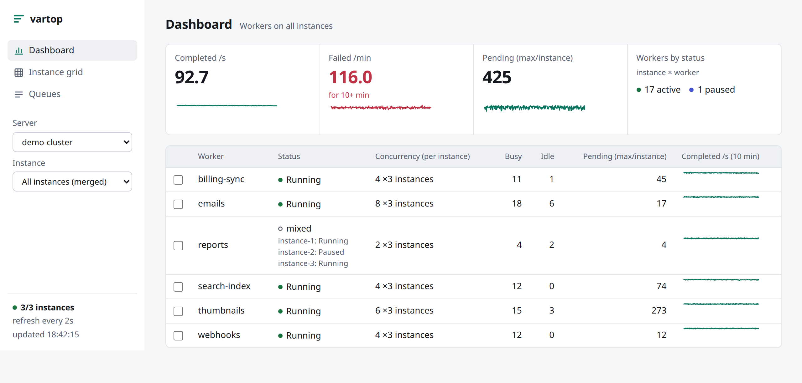
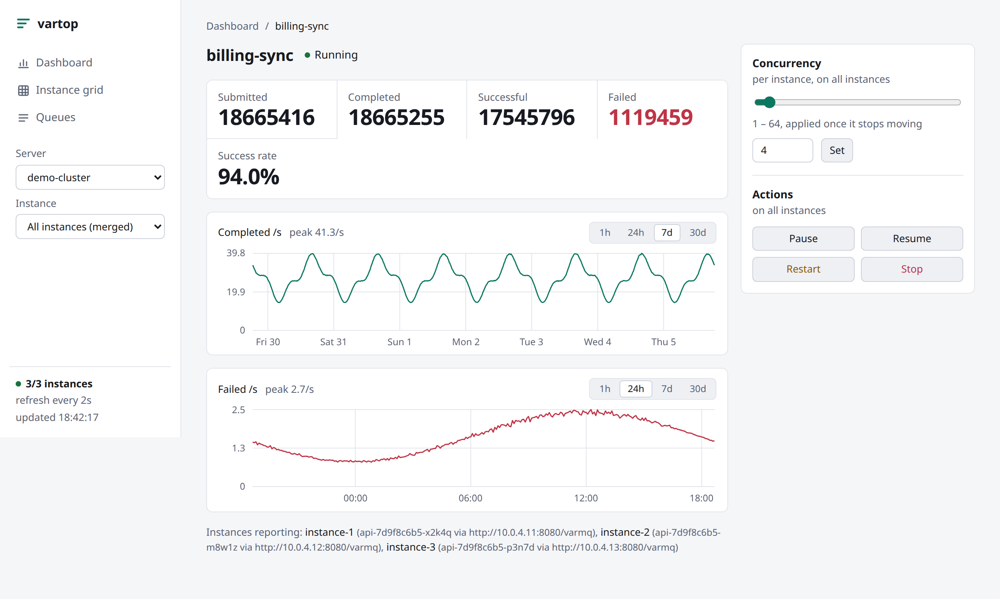
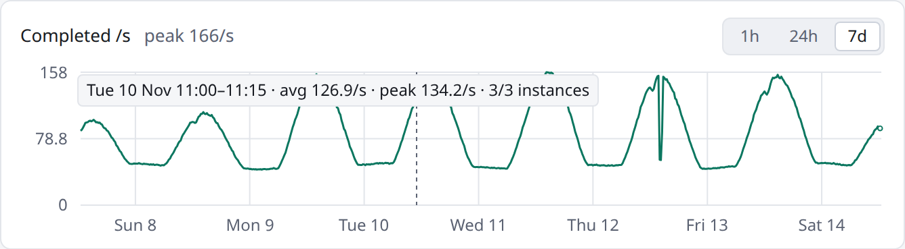
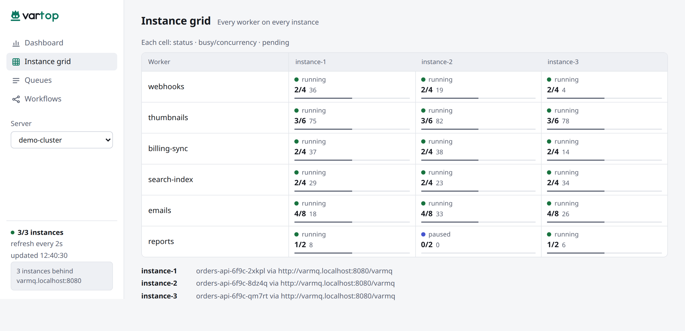
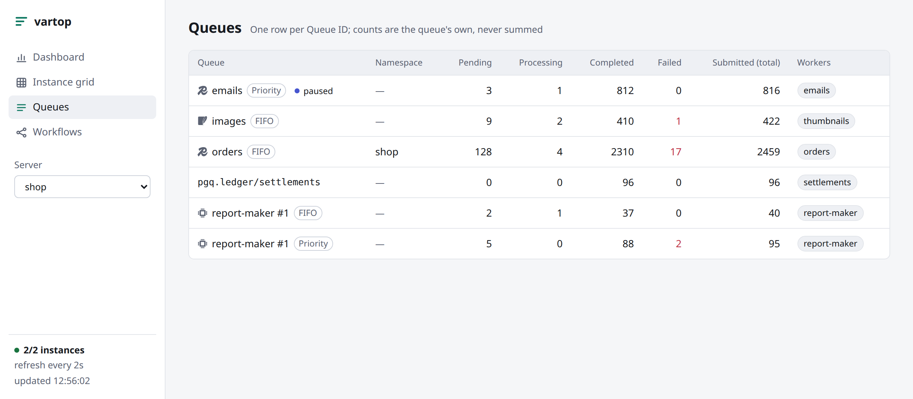
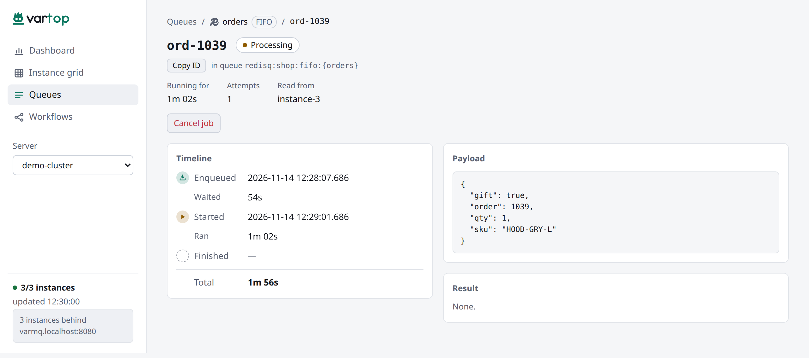
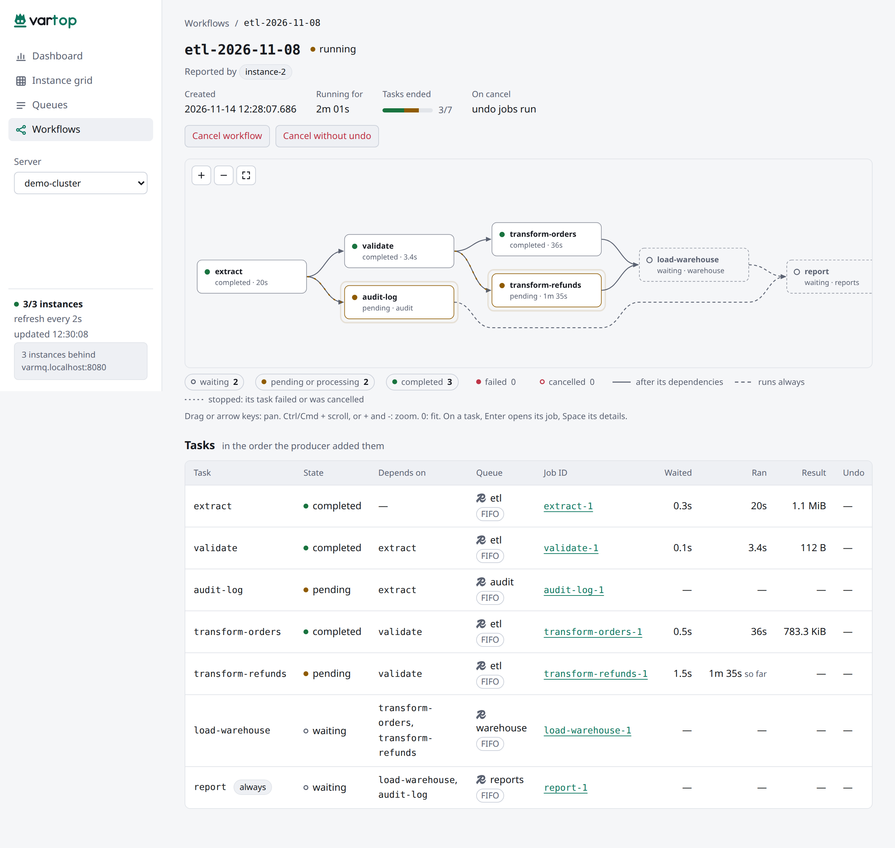

# Tour

## Dashboard

<picture>
  <source media="(prefers-color-scheme: dark)" srcset="images/dashboard-dark.png">
  
</picture>

One row per worker, merged across every instance (or one instance, from the **Instance** picker), with its status, concurrency, busy and idle workers, pending jobs and a 10-minute trend. Tick several workers to pause or resume them together. The header says how many instances answered, and here, that three of them answered behind one load-balancer URL.

## Worker page

<picture>
  <source media="(prefers-color-scheme: dark)" srcset="images/worker-dark.png">
  
</picture>

Click a worker for its totals and success rate, its two charts, and its controls. Each chart has its own span: **1h** from the stored polls, **24h** from 5-minute buckets, and **7d**, **30d** (or the server's own [`history`](configuration.md#schema), like `14d`) merged into longer steps. Hovering a chart shows how many instances answered and, on 1h, the poll's time and value; on longer spans, the exact window, its average and its peak:

<picture>
  <source media="(prefers-color-scheme: dark)" srcset="images/chart-hover-dark.png">
  
</picture>

The concurrency slider sets the pool size per instance, applied when you let go; **Pause**, **Resume**, **Restart** and **Stop** act on every instance shown.

## Instance grid

<picture>
  <source media="(prefers-color-scheme: dark)" srcset="images/grid-dark.png">
  
</picture>

Every worker on every instance: spot the one instance that is idle, stuck or behind.

## Queues

<picture>
  <source media="(prefers-color-scheme: dark)" srcset="images/queues-dark.png">
  
</picture>

**Queues** lists every queue that the instances report, one row per Queue ID. A queue in shared storage, such as Redis, shows once, however many instances report it. Each row shows the queue's name, a backend icon and its kind (FIFO or Priority). The counts are the queue's own: vartop never adds them up across instances. **Workers** names each worker that pulls from the queue, with a link to its page. A paused queue shows a **paused** badge.

Click a queue for its page. It lists the workers on the queue, and its jobs in one tab per state: pending, processing, completed, failed and cancelled. **Pause queue** and **Resume queue** ask for a confirm first. The pause is stored with the queue, so it holds on every instance.

## Job page

<picture>
  <source media="(prefers-color-scheme: dark)" srcset="images/job-dark.png">
  
</picture>

Click a job for its page. It shows the job's state, its attempts and the instance it was read from. The timeline shows when the job was enqueued, started and finished, and how long it waited and ran. While the job waits or runs, those timers tick. Each failed attempt shows its error, and the payload and the result show beside the timeline.

**Cancel job** asks for a confirm first, then asks VarMQ to cancel the job. A cancel is cooperative: a running job stops only if its handler watches its context.

## Workflows

**Workflows** lists the server's workflows (VarMQ API 1.3.0), newest first, filtered by state. A workflow in shared storage is listed by every instance that registers its workflow store (`redisq.NewWorkflowStore`, `sqliteq.NewWorkflowStore`). vartop shows it once, with the instances that report it. An instance without that store does not run the workflow's tasks. So a task can wait while its queue has workers. An in-memory workflow shows under its own instance.

<picture>
  <source media="(prefers-color-scheme: dark)" srcset="images/workflow-dark.png">
  
</picture>

A workflow's page draws its tasks as a graph. vartop lays it out: each task sits in the column of its longest path from a root. Edges into an *always* task are dashed, and a task with an undo job is marked **undo**. Drag to pan. Ctrl or Cmd + scroll (or pinch, or the buttons) zooms. Tab to a task and press Enter, or click it, for its details. The table below lists every task, with a link to each job. While the workflow runs, the page refreshes at each poll, and it stops once the workflow ends.

**Cancel workflow** cancels it as its producer chose: the undo jobs of completed tasks run if the producer said so. **Cancel without undo** turns them off. Both reach every process that works on the workflow. An instance can hold the same ID in more than one workflow store. It then answers 409, and the page says so.
